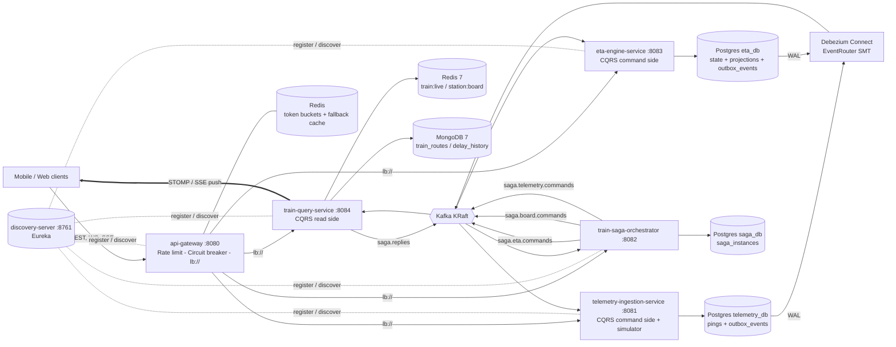

# High-Level Design - Where Is My Train Platform

## 1. Goals
Real-time railway tracking: live running status, station-to-station search with live delay, live station departure
boards, fed by GPS / cell-tower / station-crossing telemetry. Read traffic is orders of magnitude larger than write
traffic, so reads and writes are split (CQRS) and joined by an event stream (Transactional Outbox + Debezium CDC).

## 2. Architecture



ASCII view of the write path:

```
 telemetry ping
      |  POST /api/v1/telemetry  (or built-in simulator)
      v
 [telemetry-ingestion]  --BEGIN-- pings + outbox(TelemetryReceived) --COMMIT-->  Postgres WAL
                                                                                    |  Debezium EventRouter
                                                                                    v
                                            outbox.event.TelemetryReceived (Kafka, key = train:date)
                                                                                    |
                                                                       [saga-orchestrator] STARTED
                                       saga.eta.commands  <---------------------------+
                                              |
                                        [eta-engine] --BEGIN-- state + projection + outbox(EtaRecalculated|EtaFailed) --COMMIT--> WAL -> Debezium
                                                                                    |
                                       outbox.event.EtaRecalculated  -->  [saga] ETA_CALCULATED --> saga.board.commands
                                                                                                         |
                                                                              [query-service] Redis + Mongo + WS push
                                                                                                         |
                                                                                saga.replies --> [saga] BOARD_UPDATED -> COMPLETED
```

## 3. Services

| Service | Port | Role | Store |
|---|---|---|---|
| discovery-server | 8761 | Eureka registry | - |
| api-gateway | 8080 | routing, load balancing, rate limiting, circuit breaking, degraded fallbacks | Redis |
| telemetry-ingestion-service | 8081 | command: validate + persist pings, outbox, simulator | Postgres `telemetry_db` |
| train-saga-orchestrator | 8082 | saga state machine, compensations, timeout sweeper | Postgres `saga_db` |
| eta-engine-service | 8083 | command: delay/ETA propagation, anomaly detection, outbox | Postgres `eta_db` |
| train-query-service | 8084 | query: projections, REST, WebSocket, SSE | Redis + MongoDB |

## 4. Key decisions
* **No dual writes.** Services never call Kafka inside a business transaction. State + `outbox_events` row commit
  atomically; Debezium turns WAL inserts into Kafka messages (at-least-once).
* **Idempotency everywhere.** Saga start keyed by `trigger_event_id` UNIQUE; ETA commands keyed by deterministic
  command id in `processed_events`; query side uses a Redis dedup set; telemetry has a unique dedupe key.
* **Orchestration over choreography.** One component owns the workflow state, timeouts and compensation.
* **CQRS.** Writes: Postgres, strict invariants. Reads: pre-computed JSON in Redis (O(1) lookups) and Mongo
  (route search, history). The read model is eventually consistent (typically < 1 s behind).
* **Ordering.** Every message is keyed `trainNumber:journeyDate`, so a journey is totally ordered inside a partition.
* **Resilience.** Gateway: Redis token bucket + Resilience4j CircuitBreaker/TimeLimiter + cached fallbacks. Query
  service: `@CircuitBreaker @Retry @Bulkhead` around Redis and Mongo reads with stale-cache fallbacks.

## 5. Capacity estimation (India-scale sizing)
* ~13,000 passenger trains/day, ~3,000 running concurrently at peak.
* 1 ping every 10 s per running train: 3,000 / 10 = **~300 writes/s** (x3 burst = 1,000/s). Each ping fans out to
  1 saga + 1 ETA calc + 1 board update: ~900 Kafka msgs/s - trivial for a 3-broker cluster.
* Ping row ~300 B -> 300 x 86,400 x 300 B = **~7.8 GB/day** raw; keep 7 days hot (~55 GB), archive after.
* Reads: 30 M DAU x 5 lookups/day = 150 M/day = 1,700/s average, **~15,000/s peak** (morning/evening). Served from
  Redis (single node does >100k ops/s) and cached at the gateway; Mongo handles only search (~20 % of reads).
* Redis memory: live view ~6 KB x 3,000 journeys + boards (8,000 stations x ~40 trains x 0.5 KB = 160 MB) -> **< 1 GB**.
* WebSocket fan-out: 500k concurrent subscribers; scale query-service horizontally; replace the simple broker with a
  STOMP relay (RabbitMQ) or Redis pub/sub for multi-instance broadcast.

## 6. Partitioning & scaling
* Kafka: 6 partitions per topic in this demo; production 24-48, key `trainNumber:journeyDate`.
  Consumer groups: `saga-orchestrator`, `eta-engine`, `train-query`, `telemetry-ingestion` (one instance per partition).
* Postgres: partition `telemetry_pings` by `journey_date` (daily); outbox rows purged hourly.
* Redis: shard by key (`train:live:*`, `station:board:*`) with Redis Cluster; hot stations (HWH, NDLS) use hashes so a
  board is a single key lookup.
* Mongo: shard `delay_history` by `{trainNumber, journeyDate}`; `train_routes` is small and replicated.
* Stateless services scale horizontally behind Eureka + client-side load balancing.

## 7. Failure modes
| Failure | Behaviour |
|---|---|
| Kafka/Debezium down | pings keep committing to Postgres; outbox rows drain when CDC resumes (no loss) |
| Duplicate Kafka delivery | dedup tables / unique keys make handlers idempotent |
| Garbage / impossible telemetry | ETA engine emits `EtaFailed`; saga flags ping as anomaly, no projection published |
| Query store down | circuit opens; stale in-process copy served (`stale:true`) or HTTP 503 with `Retry-After` |
| Board update fails | saga compensates: `REVERT` ETA projection -> `FAILED` |
| Lost command / reply | sweeper times the saga out (30 s) and compensates |
| Query service down at gateway | circuit breaker forwards to `/fallback/query` returning last cached response |

## 8. Observability
Micrometer metrics (`/actuator/prometheus`), distributed traces to Zipkin (`:9411`), saga history persisted per
saga (`/api/v1/sagas/{id}`), circuit breaker state at `/actuator/circuitbreakers`.
