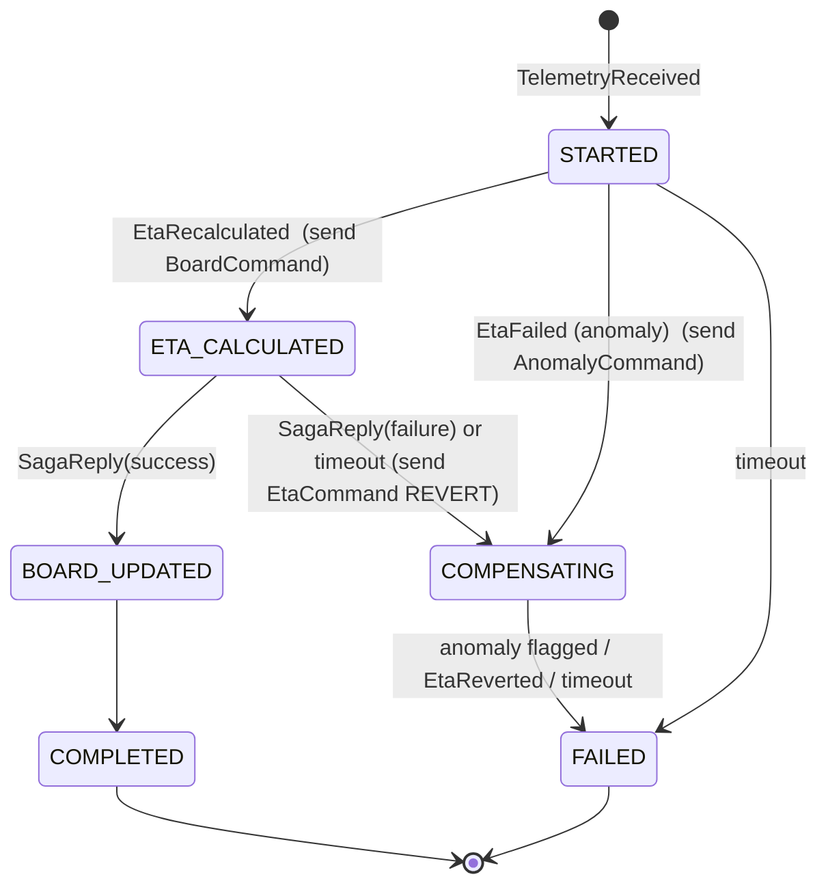
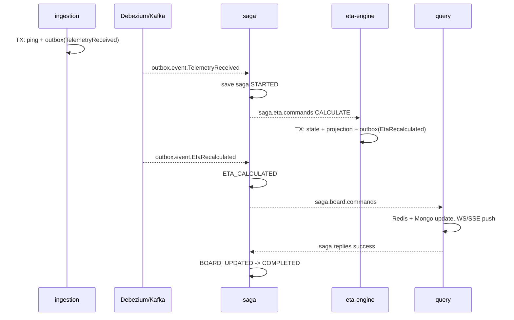

# Low-Level Design

## 1. Database schemas

### 1.1 telemetry_db (telemetry-ingestion-service)
```sql
stations(code PK, name, latitude, longitude)
trains(number PK, name, train_type, origin_code FK, destination_code FK, runs_on, max_speed_kmph)
train_schedule(id PK, train_number FK, seq, station_code FK, sch_arr TIME, sch_dep TIME, day_offset, platform,
               distance_km, UNIQUE(train_number, seq))
telemetry_pings(id BIGSERIAL PK, train_number, journey_date, event_type, station_code, latitude, longitude,
                speed_kmph, source, device_id, recorded_at TIMESTAMPTZ, dedupe_key UNIQUE,
                anomaly BOOLEAN, anomaly_reason, created_at)
outbox_events(id UUID PK, aggregatetype, aggregateid, type, payload JSONB, created_at TIMESTAMPTZ)
```

### 1.2 Outbox DDL (identical in telemetry_db and eta_db)
```sql
CREATE TABLE outbox_events (
    id            UUID         PRIMARY KEY,
    aggregatetype VARCHAR(100) NOT NULL,     -- "Train" | "TrainEta"
    aggregateid   VARCHAR(100) NOT NULL,     -- "<trainNumber>:<journeyDate>"  -> Kafka message key
    type          VARCHAR(100) NOT NULL,     -- event type -> routes to outbox.event.<type>
    payload       JSONB        NOT NULL,     -- event body (expanded to JSON by the SMT)
    created_at    TIMESTAMPTZ  NOT NULL DEFAULT now()
);
```
JDBC URLs use `?stringtype=unspecified` so Hibernate can bind the payload `String` into `JSONB`.

### 1.3 eta_db (eta-engine-service)
```sql
train_state(id PK, train_number, journey_date, last_seq, departed, delay_minutes, latitude, longitude, speed_kmph,
            last_event_at, updated_at, version, UNIQUE(train_number, journey_date))
stop_actuals(id PK, train_number, journey_date, seq, actual_arr, actual_dep, UNIQUE(train_number, journey_date, seq))
eta_projections(id PK, saga_id, train_number, journey_date, delay_minutes, reverted,
                prev_* snapshot columns, touched_seq, had_actual_row, prev_actual_arr, prev_actual_dep, created_at)
processed_events(event_id UUID PK, processed_at)
outbox_events(...)     -- see 1.2
-- + stations / trains / train_schedule reference data (same seed)
```

### 1.4 saga_db (train-saga-orchestrator)
```sql
saga_instances(id UUID PK, trigger_event_id UUID UNIQUE, train_number, journey_date, ping_id, state,
               projection_id, failure_reason, history TEXT, created_at, updated_at, version)
```

### 1.5 Redis (train-query-service)
| Key | Type | Value |
|---|---|---|
| `train:live:{trainNo}:{date}` | string | `TrainLiveView` JSON (status, position, delay, crossed/upcoming stops), TTL 3 d |
| `station:board:{code}` | hash | field `{trainNo}:{date}` -> `BoardEntry` JSON, TTL 3 d |
| `processed_events:{epochDay}` | set | command ids already applied (2 rotating days) |
| `platform:clock` | string | newest telemetry timestamp (drives boards in simulator time) |
| `gw:cache:{path?query}` | string | gateway fallback cache of successful GETs |

### 1.6 MongoDB
* `train_routes`: `{_id: trainNumber, trainName, trainType, runsOn[], stops:[{seq, code, name, platform, arr, dep, dayOffset, distanceKm}]}`, index `stops.code`.
* `delay_history`: `{trainNumber, journeyDate, stationCode, eventType, delayMinutes, recordedAt}`, index `(trainNumber, journeyDate, recordedAt)`.

## 2. Kafka topics

| Topic | Producer | Consumer | Key | Payload |
|---|---|---|---|---|
| `outbox.event.TelemetryReceived` | Debezium (telemetry_db) | saga | train:date | `TelemetryReceivedEvent` |
| `outbox.event.EtaRecalculated` | Debezium (eta_db) | saga | train:date | `EtaRecalculatedEvent` |
| `outbox.event.EtaFailed` | Debezium (eta_db) | saga | train:date | `EtaFailedEvent` |
| `outbox.event.EtaReverted` | Debezium (eta_db) | saga | train:date | `EtaRevertedEvent` |
| `saga.eta.commands` | saga | eta-engine | train:date | `EtaCommand` (CALCULATE / REVERT) |
| `saga.board.commands` | saga | query | train:date | `BoardCommand` |
| `saga.telemetry.commands` | saga | ingestion | train:date | `AnomalyCommand` |
| `saga.replies` | query | saga | train:date | `SagaReply` |
| `<topic>.DLT` | error handlers | ops | - | poison messages after 3 retries |

Debezium: `EventRouter` with `route.by.field=type`, `route.topic.replacement=outbox.event.${routedByValue}`,
`table.expand.json.payload=true`, JSON converter without schemas (see `infra/debezium/*.json`).

## 3. Saga state machine


Compensating transactions:
* **Anomaly** (backward station move, station jump > 2, speed > 250 km/h): ETA engine does not change state, emits
  `EtaFailed`; saga sends `AnomalyCommand`, ingestion sets `telemetry_pings.anomaly = true`.
* **Board failure/timeout:** saga sends `EtaCommand(REVERT, projectionId)`; ETA engine restores the snapshot stored in
  `eta_projections` (state + touched `stop_actuals` row) and emits `EtaReverted`.

### Sequence (happy path)


## 4. ETA algorithm (EtaCalculator)
* delay at station events = actual - scheduled; for GPS pings the delay is smoothed: `0.7*old + 0.3*projected`, where
  projected = (time to reach next station at current speed, haversine distance) - scheduled arrival.
* Downstream propagation: per section `recovery = min(8, 6 % of scheduled running minutes)`;
  `arrDelay(k) = max(0, carry - recovery)`; halts can shrink to 2 min; `carry` = departure delay.
* `destinationEta` = expected arrival at the last stop.

## 5. REST / WebSocket API

All paths work directly on the service ports and through the gateway (`:8080`).

| Method & path | Service | Description |
|---|---|---|
| `POST /api/v1/telemetry` | ingestion | submit a ping (202, 200 duplicate, 422 invalid) |
| `GET /api/v1/telemetry/recent?trainNumber=&journeyDate=` | ingestion | last 20 pings |
| `POST /api/v1/simulator/start|stop`, `GET /status`, `POST /inject-anomaly` | ingestion | simulator control |
| `GET /api/v1/query/trains/{no}/running-status?journeyDate=` | query | live running status |
| `GET /api/v1/query/trains/between?from=&to=&date=` | query | station-to-station search |
| `GET /api/v1/query/stations/{code}/board?hours=4&asOf=` | query | live departure board |
| `GET /api/v1/query/trains/{no}/delay-history?journeyDate=` | query | Mongo delay history |
| `GET /api/v1/stream/trains/{no}/{date}` | query | SSE stream (`snapshot`, `live-update`) |
| `GET /api/v1/sagas`, `/stats`, `/{id}` | saga | inspect sagas |
| `GET /api/v1/eta/{no}/{date}/state|latest-projection` | eta | write-side diagnostics |

`TelemetryRequest`:
```json
{"trainNumber":"22895","journeyDate":"2026-11-17","eventType":"STATION_ARRIVAL","stationCode":"KGP",
 "latitude":22.3396,"longitude":87.3202,"speedKmph":15,"source":"STATION_CROSSING",
 "recordedAt":"2026-11-17T01:58:00Z","deviceId":"demo"}
```

WebSocket (STOMP over SockJS): endpoint `/ws`; subscribe `/topic/trains/{trainNumber}/{journeyDate}` (`LiveDiff`)
and `/topic/stations/{stationCode}` (`BoardEntry`).

`LiveDiff`: `{type, trainNumber, journeyDate, status, delayMinutes, previousDelayMinutes, lastCrossedStation,
nextStation, latitude, longitude, speedKmph, destinationEta, recordedAt, changedStops[]}`.

## 6. Gateway
Routes: `/api/v1/query/**` (CB `queryCb`), `/api/v1/stream/**` (SSE, no CB), `/ws/**` (`lb:ws://` + SockJS HTTP),
`/api/v1/telemetry|simulator/**` (CB `ingestCb`), `/api/v1/sagas/**`, `/api/v1/eta/**`.
Default filter `RequestRateLimiter`: Redis token bucket `replenishRate=20`, `burstCapacity=40`, key = `X-API-Key` or client IP.
`ResponseCacheFilter` stores successful query GETs; `/fallback/query` returns the cached body (`X-Degraded: cached-response`).
